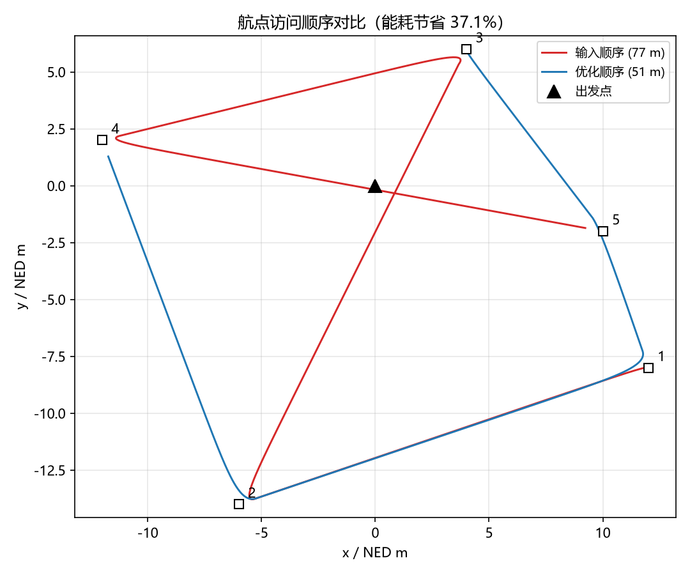
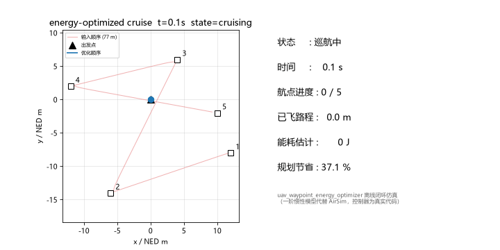

# 基于能耗模型的多航点访问顺序优化与巡航

`uav_waypoint_energy_optimizer` 解决"多个目标点按什么顺序访问最省电"的问题：给定出发点与一组目标航点，用简化多旋翼能耗模型评估任意访问顺序的开销，最近邻 + 2-opt 启发式搜索低能耗顺序，然后由巡航状态机按优化顺序依次飞越全部航点。与已有的[航点轨迹跟踪（PID 控制）](../waypoint_tracking.md)不同：前者解决"怎么精确跟踪给定路径"，本模块解决"路径本身该怎么排序"；与[固定路线巡航](../uav_route_cruise.md)不同：本模块的路线在任务开始时由优化器自动生成。与[阿基米德螺旋搜索](../uav_spiral_search/spiral_search.md)构成任务链：搜索锁定目标后，多目标点的访问顺序可交由本模块优化。

无人机须先在仿真器中起飞并稳定悬停（本模式不负责解锁、起飞或降落），巡航过程中保持固定航向（桥接 `hold_heading` 模式）。

## 实验原理

### 简化多旋翼能耗模型

功率取教学常用简化形式：悬停功率 `P0` 与随速度二次增长的推进功率 `c·v²`，即 `P(v) = P0 + c·v²`。飞完距离 `d` 的能耗：

```
E_cruise = (P0 + c·v²) · d / v
```

该模型复现多旋翼的真实特性：能耗-速度曲线存在最优巡航速度 `v* = √(P0/c)`，并非飞得越快越省电（默认参数下 `v* ≈ 7.1 m/s`，模块默认巡航速度取保守的 2 m/s 以适配仿真器）。转向时无人机减速悬停，按最大偏航角速度 `ω` 计算悬停时间，转向能耗 `E_turn = P0·|Δψ|/ω`。由于转向开销与进入方向有关，同一组点的能耗矩阵是**非对称**的，这是对经典 TSP 的一个小扩展。

### 访问顺序优化：最近邻 + 2-opt

1. **最近邻构造**：从出发点开始，每步选未访问点中欧氏距离最近者，得到初始顺序；
2. **2-opt 改进**：反复反转路径的子段，只要总能耗下降就接受，直到无改进或达到迭代上限（默认 1000 次）。

启发式不保证全局最优（TSP 是 NP 难），但结果确定、毫秒级完成，且显著优于按输入顺序直接飞行。默认 5 航点场景：输入顺序 6944 J / 94.6 m，优化后 4367 J / 59.6 m，**能耗节省 37.1%**。

### 巡航状态机

```
waiting_odom ──里程计有效──> cruising ──依次到达全部航点──> arrived（最后航点上方悬停）
```

每个控制周期（20 Hz）朝当前航点输出世界系速度指令（水平 P 控制饱和于 `max_speed`，高度独立 P 控制保持 `cruise_altitude`），进入到达半径 `arrival_radius` 后切换下一航点；同时用能耗模型在线累计能耗估计，与规划值对比。



## 运行步骤

以下命令在完成[环境配置](../openhutb_yolo_mlp_control/setup.md)中的依赖安装、功能包构建并加载工作空间后运行。先设置仓库根目录和 Windows 主机地址：

```bash
export REPO_DIR=/绝对路径/到/ros2
export AIRSIM_IP=实际Windows地址
nc -vz "$AIRSIM_IP" 41451
```

构建本包（在 ROS 2 工作空间根目录，需先构建 `openhutb_yolo_mlp_control`）：

```bash
colcon build --packages-select uav_waypoint_energy_optimizer
source install/setup.bash
```

### 预览模式（不发送飞行指令）

```bash
ros2 launch uav_waypoint_energy_optimizer waypoint_energy_optimizer.launch.py \
  airsim_ip:="$AIRSIM_IP" \
  dry_run:=true
```

启动日志会打印优化结果（优化顺序、能耗对比、节省百分比）。在另一个已加载工作空间环境的终端查看任务状态：

```bash
ros2 topic echo /openhutb/waypoint_energy/status
```

### 仿真控制

确认无人机已稳定悬停、并停止其他飞行指令发布者后：

```bash
ros2 launch uav_waypoint_energy_optimizer waypoint_energy_optimizer.launch.py \
  airsim_ip:="$AIRSIM_IP" \
  dry_run:=false
```

也可从任意当前目录调用仓库入口脚本：

```bash
bash "$REPO_DIR/src/air/uav_waypoint_energy_optimizer/main.sh" \
  airsim_ip:="$AIRSIM_IP" \
  dry_run:=false
```

全部航点访问完成后无人机在最后航点上方悬停；退出 ROS 节点不会自动降落，由操作者按照仿真器流程接管无人机。

## 离线闭环仿真演示

无需 AirSim 即可验证：`tools/compare_routes.py` 让同一巡航控制器分别按输入顺序与优化顺序飞完全部航点并输出量化对比；`tools/make_demo_gif.py` 生成任务动画：



复现命令（无需 ROS，任意 Python 3.10+）：

```bash
python3 tools/compare_routes.py --plot compare.png
python3 tools/make_demo_gif.py --output demo.gif
```

## 常用参数与状态

| 参数 | 默认值 | 作用 |
| --- | --- | --- |
| `dry_run` | `true` | 预览模式，不发送飞行控制指令 |
| `waypoints` | `[12,-8,-6,-14,4,6,-12,2,10,-2]` | 目标航点（展平的 `[x1,y1,...]` 列表，NED 米） |
| `start_x` / `start_y` | `0` / `0` | 出发点（优化起点） |
| `return_to_start` | `false` | 访问完全部航点后返回出发点 |
| `energy_hover_power` | `120.0` | 悬停功率 P0，单位 W |
| `energy_drag_coeff` | `2.4` | 推进功率系数 c |
| `energy_cruise_speed` | `2.0` | 能耗模型评估用巡航速度，单位 m/s |
| `energy_yaw_rate_max` | `1.5` | 最大偏航角速度，单位 rad/s |
| `cruise_altitude` | `-5.0` | 巡航高度（NED，负值代表高度） |
| `arrival_radius` | `0.8` | 航点到达半径，单位 m |
| `max_speed` | `2.0` | 水平速度上限，单位 m/s |

状态发布在 `/openhutb/waypoint_energy/status`（JSON 字符串），字段包括：`state`（`waiting_odom` / `cruising` / `arrived` / `odom_stale`）、`waypoints_done` / `waypoints_left` / `progress_percent`（航点进度）、`distance_done_m`（已飞路程）、`energy_done_j`（在线能耗估计）与 `energy_planned_j`（规划值）、`optimized_order` 与 `energy_saving_percent`（规划结果）。预览速度发布在 `/openhutb/waypoint_energy/preview_cmd_vel`。

## 已知限制

- 能耗模型为简化教学模型（悬停功率 + 速度平方项），未建模电池放电特性与风场；绝对数值仅作相对比较；
- 最近邻 + 2-opt 为启发式，不保证全局最优；航点数增多（>12）时可考虑替换为 OR-Tools 等求解器；
- 巡航保持固定航向（`hold_heading`），能耗模型中的转向开销按悬停时间近似。

返回[文档目录](README.md)。

## 说明

本文档整理、代码重构和问题排查过程中使用了大模型辅助；提交者已检查全部内容并对最终结果负责。
